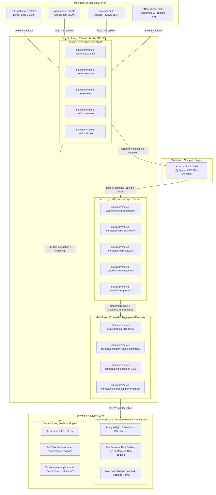

# 🛍️ Enterprise Multi-Source E-Commerce Data Lakehouse & Analytics Platform

A complete, production-ready enterprise-grade E-Commerce Data Lakehouse and Analytics Platform built from scratch. This project demonstrates modern cloud data engineering architectures using the **Medallion Pattern (Bronze → Silver → Gold)**, distributed PySpark processing, data warehousing (simulating Amazon Redshift), and full-text search & log analytics (Elasticsearch).

---

## 🏛️ Architecture Overview



---

## 💎 The Medallion Architecture (Lakehouse Design)

The platform strictly adheres to the standard **Medallion Lakehouse Architecture**:

| Layer | Purpose | Storage & Format | Characteristics |
| :--- | :--- | :--- | :--- |
| **Bronze** | Raw data ingestion | MinIO S3 (`s3://ecommerce-raw/`), Raw JSON & CSV | Immutable, append-only, date-partitioned raw logs preserving exact source payload with corrupted record capture (`PERMISSIVE`). |
| **Silver** | Cleaned, validated, typed | MinIO S3 (`s3://ecommerce-curated/silver/`), Snappy-compressed Parquet | Enforces strict schemas, cleans dirty/missing data, standardizes dates/monetary values, deduplicates records, and attaches ETL audit lineage. |
| **Gold** | Curated business datasets | MinIO S3 (`s3://ecommerce-curated/gold/`), Partitioned Parquet | Denormalized star-schema facts, exploded line-item facts, Customer 360 view, Product performance KPIs, and daily sales rollups. |

---

## 🗂️ Project Directory Structure

```text
ETL/
├── docker-compose.yml              # Multi-container orchestration (MinIO, Postgres, Spark, ES, Pipeline)
├── Dockerfile                      # Python execution container with analytical dependencies
├── requirements.txt                # Python libraries (pyspark, boto3, psycopg2, elasticsearch, etc.)
├── .env.example                    # Template environment variables
├── .env                            # Active environment configuration
├── config/
│   ├── elasticsearch.yml           # Custom cluster, shard, and buffer configuration
│   └── spark-defaults.conf         # Spark driver/executor tuning & S3A connectors
├── data_generator/
│   ├── __init__.py
│   └── generate_data.py            # Multi-source mock generator (Transactions, Clickstream, Reviews, Dimensions)
├── etl/
│   ├── __init__.py
│   ├── schema_definitions.py       # Strict PySpark StructType schemas for all source entities
│   └── spark_etl.py                # Medallion ETL processor (Bronze → Silver → Gold)
├── warehouse/
│   ├── __init__.py
│   ├── ddl.sql                     # Staging & Analytics schemas, tables, indexes, materialized views
│   └── load_warehouse.py           # High-throughput COPY bulk loader from S3 into PostgreSQL
├── search/
│   ├── __init__.py
│   └── index_elasticsearch.py      # Elasticsearch bulk indexer with custom analyzers & aggregations
├── orchestrator/
│   ├── __init__.py
│   └── pipeline.py                 # End-to-end automated pipeline runner with error handling & telemetry
└── scripts/
    ├── init-minio.sh               # MinIO bucket bootstrapping script
    ├── wait-for-it.sh              # TCP service synchronization utility
    └── verify_pipeline.py          # Post-run automated health check and verification script
```

---

## 🚀 Key Platform Components

### 1. Multi-Source Ingestion Simulation (`data_generator/`)
- Generates 5 distinct, interrelated datasets:
  - **Transaction Logs (`JSON`)**: Nested order records with exploded line items, tax, discounts, payments, and simulated data quality anomalies (~5% dirty data).
  - **Clickstream Events (`JSON`)**: Page views, search queries, cart additions, checkout steps, geo-location, and user agents.
  - **Customer Reviews (`JSON`)**: Unstructured customer review text, titles, ratings (1–5), verified flags, and votes.
  - **Customer Profiles (`CSV`)**: Master customer dimension with loyalty tiers, addresses, and demographic attributes.
  - **Product Catalog (`CSV`)**: Master product dimension with SKU, brand, cost, weight, categories, and inventory.
- Implements partitioned upload to S3 (`year=YYYY/month=MM/day=DD`) via `boto3`.

### 2. Distributed PySpark ETL Engine (`etl/`)
- Simulates an **AWS Glue** PySpark job.
- **Strict Schema Enforcement**: Custom `StructType` definitions with corrupt record quarantine.
- **Silver Processing**: Cleanses nulls, standardizes timestamps, normalizes status strings, deduplicates with window functions (`row_number() over (partition by id order by timestamp desc)`).
- **Gold Aggregations**:
  - `gold_order_facts`: Explodes line items into granular item-level fact records.
  - `gold_daily_sales_summary`: Daily rollups for order volume, revenue, units sold, and AOV.
  - `gold_customer_360`: Joins transactional metrics, browsing frequency, and review activities per customer into a composite engagement score.
  - `gold_product_performance`: Computes unit sales, margins, return/sentiment ratios, and review stats.
- Output written in **Snappy-compressed partitioned Parquet** format.

### 3. Analytical Data Warehouse (`warehouse/`)
- Simulates **Amazon Redshift** using an optimized PostgreSQL 16 instance.
- **DDL Design (`ddl.sql`)**:
  - Three schema tiers: `staging`, `analytics`, and `reporting`.
  - Analytical star-schema with `analytics.fact_orders`, `analytics.dim_customers`, `analytics.dim_products`, and `analytics.agg_daily_sales`.
  - Redshift-like distribution and sort keys simulated via B-Tree compound indexes.
  - Materialized views with automatic refresh: `reporting.mv_weekly_sales` and `reporting.mv_category_performance`.
  - Analytical reporting views: `v_monthly_revenue`, `v_top_products`, `v_customer_segments`, and `v_geographic_sales`.
- **Bulk Loading (`load_warehouse.py`)**: Uses high-speed streaming `COPY` commands from S3 staging files directly into PostgreSQL.

### 4. Elasticsearch Search & Log Analytics (`search/`)
- Indexes semi-structured and unstructured data:
  - **`ecommerce-reviews` Index**: Configured with custom analyzers (`lowercase`, `stop`, `snowball` stemmer) for full-text review search, rating faceting, and sentiment classification.
  - **`ecommerce-clickstream` Index**: Configured for high-throughput time-series search and event-type aggregations with IP address data types.
- Uses bulk indexing (`helpers.bulk`) with retry exponential backoff.

### 5. Unified Orchestrator (`orchestrator/pipeline.py`)
- Coordinates the end-to-end execution of all 4 pipeline stages sequentially.
- Captures runtime durations, logs, and ensures failure containment.

---

## ⚡ Quickstart Guide (Local Execution)

### Prerequisites
- [Docker](https://docs.docker.com/get-docker/) & [Docker Compose](https://docs.docker.com/compose/) installed on your machine.
- 4GB+ free RAM allocated to Docker.

### 1. Clone & Configure
Ensure your `.env` file is in place (pre-configured with local credentials):
```bash
cp .env.example .env
```

### 2. Launch the Entire Lakehouse Cluster
Run Docker Compose to build and start all containers:
```bash
docker-compose up --build
```

The `pipeline` container will automatically wait for MinIO, PostgreSQL, Elasticsearch, and Spark Master to report healthy, and then execute:
1. `data_generator.py` (Generate & upload raw data to MinIO)
2. `spark_etl.py` (PySpark Bronze → Silver → Gold transforms)
3. `load_warehouse.py` (Load Gold data into PostgreSQL Analytical Warehouse)
4. `index_elasticsearch.py` (Index Reviews and Clickstream into Elasticsearch)

---

## 🖥️ Web UI & Access Endpoints

Once running, access any of the services locally:

| Service | Endpoint | Credentials | Description |
| :--- | :--- | :--- | :--- |
| **MinIO Console** | [http://localhost:9001](http://localhost:9001) | `lakehouse_admin` / `lakehouse_secret_2024` | Inspect S3 buckets (`ecommerce-raw` & `ecommerce-curated`) |
| **Spark Master UI** | [http://localhost:9090](http://localhost:9090) | *None* | Spark cluster status, active workers & job executions |
| **Elasticsearch** | [http://localhost:9200](http://localhost:9200) | *None* | Elasticsearch cluster health and search API |
| **PostgreSQL** | `localhost:5432` | `warehouse_admin` / `warehouse_secret_2024` / `ecommerce_warehouse` | Analytical SQL queries |

---

## 🧪 Post-Run Verification

### Option A: Automated Health Check Script
Run the automated verification script from your host (with Python 3 and requirements installed) or inside the Docker container:
```bash
docker exec -it lakehouse-pipeline python /app/scripts/verify_pipeline.py
```

### Option B: Querying PostgreSQL Warehouse
Connect to PostgreSQL using `psql` or any SQL client (DBeaver, TablePlus, pgAdmin):
```bash
docker exec -it lakehouse-postgres psql -U warehouse_admin -d ecommerce_warehouse
```

Run sample analytical queries:

```sql
-- 1. Monthly Revenue & Order Volume
SELECT * FROM reporting.v_monthly_revenue LIMIT 10;

-- 2. Top 5 Revenue-Generating Products
SELECT product_id, name, category, total_revenue, total_units_sold, avg_review_rating
FROM reporting.v_top_products
LIMIT 5;

-- 3. Customer Segments Breakdown
SELECT customer_segment, COUNT(*), ROUND(AVG(total_spend), 2) AS avg_spend
FROM reporting.v_customer_segments
GROUP BY customer_segment
ORDER BY avg_spend DESC;

-- 4. Category Performance from Materialized View
SELECT * FROM reporting.mv_category_performance LIMIT 5;
```

### Option C: Querying Elasticsearch
Run full-text search against customer reviews:
```bash
curl -X GET "http://localhost:9200/ecommerce-reviews/_search?pretty" -H 'Content-Type: application/json' -d'
{
  "query": {
    "multi_match": {
      "query": "excellent quality build",
      "fields": ["review_title", "review_text"]
    }
  },
  "size": 2
}'
```

---

## 🧹 Tear Down & Reset

To stop all services and preserve data volumes:
```bash
docker-compose down
```

To completely reset the platform (erasing all databases, S3 objects, and Elasticsearch indices):
```bash
docker-compose down -v
```

